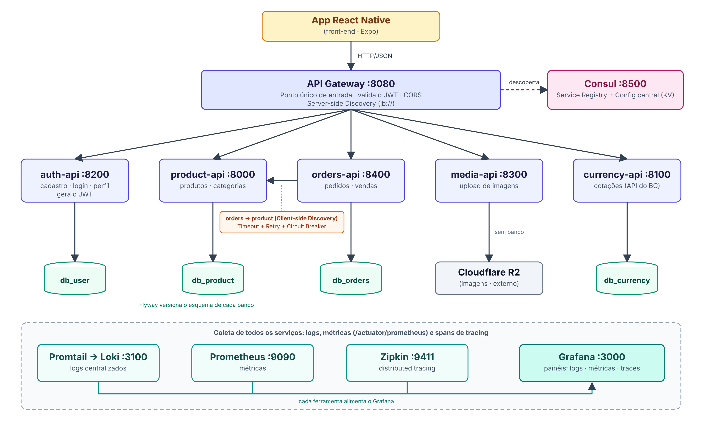
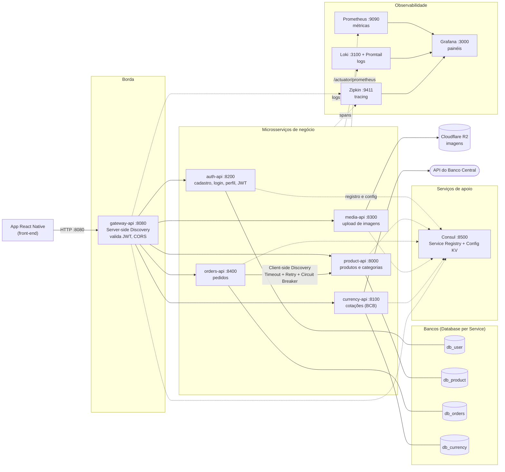

# Arquitetura do back-end – Pixel Hunter

Back-end em **microsserviços** (Java 21, Spring Boot, Spring Cloud). O aplicativo (React Native) conversa só com o **API Gateway**.

## Diagrama geral

## Microsserviços e responsabilidades

| Serviço | Porta | Responsabilidade | Banco |
|---|---|---|---|
| gateway-api | 8080 | Único ponto de entrada. Roteia por nome de serviço (`lb://`), valida o JWT nas rotas `/ws/**`, repassa a identidade em `X-User-Id`, `X-User-Type` e `X-User-Email` e responde o CORS | — |
| auth-api | 8200 | Cadastro, login (gera o JWT), perfil e foto do usuário. Perfis `BUYER` e `SELLER` | `db_user` |
| product-api | 8000 | Catálogo: produtos, categorias, busca e produtos do vendedor | `db_product` |
| orders-api | 8400 | Pedidos do comprador e histórico de vendas do vendedor. Consulta título, preço e vendedor no product-api | `db_orders` |
| media-api | 8300 | Recebe imagens (PNG/JPG/WebP até 5 MB) e as envia ao Cloudflare R2 | — |
| currency-api | 8100 | Cotações de moeda (API do Banco Central) com Retry e Circuit Breaker | `db_currency` |

## Comunicação entre serviços

- **Externa (app → back-end):** HTTP/JSON para o gateway. O gateway localiza o serviço de destino no Consul (Server-side Discovery).
- **Interna (serviço → serviço):** `orders-api → product-api`, em `http://product-api`, resolvido pelo Consul com Spring Cloud LoadBalancer (Client-side Discovery). Nenhum IP ou porta fixa no código.
- **Resiliência dessa chamada:** Timeout (conexão 2 s, leitura 2 s), Retry (3 tentativas, sem repetir erros 4xx) e Circuit Breaker. Com o product-api fora do ar, o orders-api responde `503` com mensagem clara em vez de travar. Os parâmetros ficam no Consul.
- **Identidade:** o gateway valida o JWT uma vez e repassa `X-User-*`. Os serviços não recebem a senha nem o token e não autenticam de novo. Cabeçalhos `X-User-*` enviados pelo cliente são descartados.

## Padrões adotados

| Padrão pedido | Como foi atendido |
|---|---|
| Database per Service | Um PostgreSQL por serviço (`product-db`, `auth-db`, `orders-db`, `currency-db`), sem tabelas compartilhadas |
| Versionamento de banco | **Flyway** em auth, product, orders e currency (`src/main/resources/db/migration`) |
| Externalized Configuration | Configurações vêm do Consul e de variáveis de ambiente (`docker/.env`), não do código nem das imagens |
| Centralized Configuration | **Consul KV**, carregado pelo container `consul-config` (`docker/config/load-config.sh`) |
| Service Registry / Self Registration | **Consul**; cada serviço se registra ao iniciar (`spring-cloud-starter-consul-discovery`) |
| Client-side / Server-side Discovery | LoadBalancer no orders-api / gateway com `lb://` |
| API Gateway | Spring Cloud Gateway (WebFlux) |
| Autenticação stateless | **JWT** assinado digitalmente (HMAC) gerado no auth-api e validado no gateway |
| Logs | Promtail → **Loki** → Grafana |
| Métricas | Micrometer → **Prometheus** → Grafana |
| Distributed Tracing | Micrometer Tracing → **Zipkin** (gateway → orders → product no mesmo trace) |
| Service per Container | Um Dockerfile por serviço e um container por serviço no `docker-compose.yml` |
| Dados persistentes | Volumes Docker nos bancos, no Loki, Prometheus e Grafana |
| Camadas, DTOs, validação | Controller → Service → Repository; DTOs separados das entidades; `GlobalExceptionHandler` em cada serviço, sem expor detalhes internos |

## Rotas públicas e protegidas (gateway)

| Prefixo | Acesso |
|---|---|
| `/auth/**`, `/products/**`, `/categories/**`, `/currencies/**` | Públicas |
| `/ws/**` (users, products, media, orders, currencies) | Protegidas: exigem `Authorization: Bearer <token>` válido |

Dentro das rotas protegidas, os serviços ainda verificam o perfil: só `SELLER` cria, edita e exclui produtos e envia imagens; só `BUYER` cria e consulta pedidos.

## Decisões arquiteturais e adaptações

1. **Banco por serviço.** Seguimos o padrão preferencial. O media-api não tem banco porque só guarda a imagem no R2 e devolve a URL.
2. **Moeda.** O catálogo foi simplificado para preços em reais, conforme o contrato do app. A conversão de moeda deixou de ser feita no product-api. O currency-api continua como serviço independente, mantendo Retry e Circuit Breaker na chamada ao Banco Central. A comunicação entre dois serviços de negócio é demonstrada por `orders-api → product-api`.
3. **Pagamento.** O pedido é criado já como `CONFIRMED`: a venda é de itens digitais e o fluxo de pagamento não faz parte do escopo.
4. **Segredos.** JWT, senha do banco, senha do Grafana e chaves do R2 vêm de variáveis de ambiente. Nada disso fica no código. Por isso o `docker/.env` não é versionado (só o `.env.example`).
5. **Promtail.** Lê os logs dos containers pelo `docker.sock` (somente leitura). É aceitável para desenvolvimento e demonstração, mas não para produção.
6. **Actuator.** Só `health`, `info`, `metrics` e `prometheus` ficam expostos, para não revelar `env`, `beans` nem `heapdump`.
7. **CORS.** Liberado só no gateway, para o app rodar também no navegador.
